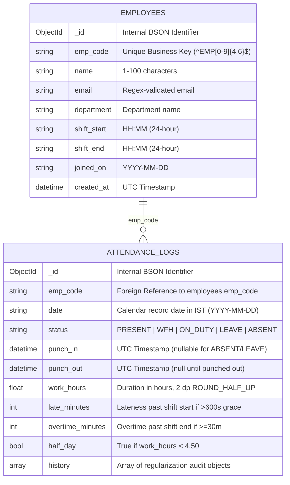

# DATA_MODEL.md — MongoDB Data Architecture & Schemas

This document provides the complete database design, collection specifications, BSON data types, indexing strategy, concurrency constraints, and document samples for the **Smart Attendance API**.

---

## 1. Architectural Overview

The application utilizes MongoDB 6+/7 as its primary datastore, organized around two core collections:
1. `employees`: Master employee records, organizational metadata, and shift configurations.
2. `attendance_logs`: Daily attendance records, shift timestamps, derived metrics, and immutable regularization audit logs.

### Entity Relationship Diagram


---

## 2. Collection Specifications

### 2.1 `employees` Collection

Stores employee records. Every employee has a fixed work shift and onboarding date.

| Field Name | BSON Type | Python / API Type | Constraints & Description |
|---|---|---|---|
| `_id` | `ObjectId` | Stripped at API | Auto-generated MongoDB primary key. |
| `emp_code` | `String` | `str` | **Unique**. Pattern `^EMP\d{4,6}$` (e.g., `EMP1001`). |
| `name` | `String` | `str` | `1` to `100` characters. |
| `email` | `String` | `str` | Must match regex `^[^@\s]+@[^@\s]+\.[^@\s]+$`. |
| `department` | `String` | `str` | Department name (e.g., `Engineering`, `Product`). |
| `shift_start` | `String` | `str` | 24-hour time format `HH:MM` (e.g., `09:30`). |
| `shift_end` | `String` | `str` | 24-hour time format `HH:MM` (e.g., `18:30`). Must differ from `shift_start`. |
| `joined_on` | `String` | `str` | Date string `YYYY-MM-DD`. Validated calendar date. |
| `created_at` | `Date` | `int` (epoch ms) | Creation timestamp in UTC; returned as epoch ms. |

#### Sample `employees` Document
```json
{
  "_id": {"$oid": "6618451c2f90a1b2c3d4e5f0"},
  "emp_code": "EMP1001",
  "name": "Jane Doe",
  "email": "jane.doe@example.com",
  "department": "Engineering",
  "shift_start": "09:30",
  "shift_end": "18:30",
  "joined_on": "2026-01-15",
  "created_at": {"$date": "2026-01-15T04:00:00.000Z"}
}
```

---

### 2.2 `attendance_logs` Collection

Stores attendance records. A unique composite index on `(emp_code, date)` guarantees at most one record per employee per attendance date.

| Field Name | BSON Type | Python / API Type | Constraints & Description |
|---|---|---|---|
| `_id` | `ObjectId` | Stripped at API | Auto-generated MongoDB primary key. |
| `emp_code` | `String` | `str` | References `employees.emp_code`. |
| `date` | `String` | `str` | Record date in IST (`YYYY-MM-DD`). |
| `status` | `String` | `str` | `PRESENT`, `WFH`, `ON_DUTY`, `LEAVE`, `ABSENT`. |
| `punch_in` | `Date` / `Null` | `int` (epoch ms) / `None` | Truncated to whole seconds; stored in UTC. |
| `punch_out` | `Date` / `Null` | `int` (epoch ms) / `None` | Null until punch-out; must be $> \text{punch\_in}$. |
| `work_hours` | `Double` / `Null`| `float` / `None` | `(punch_out - punch_in) / 3600`, 2 dp `ROUND_HALF_UP`. |
| `late_minutes`| `Int32` | `int` | $\lfloor \text{seconds} / 60 \rfloor$ from shift start if $> 600\text{s}$, else `0`. |
| `overtime_minutes`| `Int32`| `int` | $\lfloor \text{seconds} / 60 \rfloor$ past shift end if $\ge 30\text{m}$, else `0`. |
| `half_day` | `Boolean` | `bool` | `work_hours < 4.50` after punch-out; else `false`. |
| `history` | `Array` | `list[HistoryItem]` | Array of regularization history audit items. |

#### Sample `attendance_logs` Document (Complete Shift)
```json
{
  "_id": {"$oid": "6618451c2f90a1b2c3d4e5f1"},
  "emp_code": "EMP1001",
  "date": "2026-03-02",
  "status": "PRESENT",
  "punch_in": {"$date": "2026-03-02T04:12:00.000Z"},
  "punch_out": {"$date": "2026-03-02T13:30:00.000Z"},
  "work_hours": 9.30,
  "late_minutes": 12,
  "overtime_minutes": 30,
  "half_day": false,
  "history": []
}
```

#### Sample `attendance_logs` Document (Overnight Shift: 22:00 - 06:00)
```json
{
  "_id": {"$oid": "6618451c2f90a1b2c3d4e5f2"},
  "emp_code": "EMP1002",
  "date": "2026-03-02",
  "status": "PRESENT",
  "punch_in": {"$date": "2026-03-02T16:30:00.000Z"},
  "punch_out": {"$date": "2026-03-03T01:00:00.000Z"},
  "work_hours": 8.50,
  "late_minutes": 0,
  "overtime_minutes": 30,
  "half_day": false,
  "history": []
}
```

#### Sample `attendance_logs` Document (With Regularization History)
```json
{
  "_id": {"$oid": "6618451c2f90a1b2c3d4e5f3"},
  "emp_code": "EMP1001",
  "date": "2026-03-03",
  "status": "PRESENT",
  "punch_in": {"$date": "2026-03-03T04:00:00.000Z"},
  "punch_out": {"$date": "2026-03-03T13:00:00.000Z"},
  "work_hours": 9.00,
  "late_minutes": 0,
  "overtime_minutes": 0,
  "half_day": false,
  "history": [
    {
      "at": 1772544600000,
      "by": "MGR001",
      "reason": "Corrected missed punch-out timestamp",
      "changes": {
        "punch_out": {
          "from": null,
          "to": 1772542800000
        },
        "work_hours": {
          "from": null,
          "to": 9.00
        }
      }
    }
  ]
}
```

---

## 3. Database Indexes

Indexes are created idempotently at application startup via FastAPI's lifespan handler.

### 3.1 `employees` Collection Indexes

| Index Name | Keys | Attributes | Purpose |
|---|---|---|---|
| `uniq_emp_code` | `{"emp_code": 1}` | **Unique** | Enforces unique employee business codes; eliminates check-then-insert races. |
| `idx_dept_emp_code`| `{"department": 1, "emp_code": 1}` | Compound | Powers filtered employee pagination and trend queries. |
| `idx_dept_joined_on`| `{"department": 1, "joined_on": 1}` | Compound | Optimizes department-scoped headcount aggregations. |
| `idx_joined_on` | `{"joined_on": 1}` | Single | Optimizes company-wide headcount calculations across departments. |

### 3.2 `attendance_logs` Collection Indexes

| Index Name | Keys | Attributes | Purpose |
|---|---|---|---|
| `uniq_emp_code_date` | `{"emp_code": 1, "date": 1}` | **Unique** | Enforces single shift record per employee per day; monthly analytics lookups. |
| `idx_date_desc_emp_code` | `{"date": -1, "emp_code": 1}` | Compound | Powers `GET /attendance` pagination and default sorting with zero in-memory sort. |
| `idx_date_late_emp` | `{"date": 1, "late_minutes": 1, "emp_code": 1}` | Compound | Covers late leaderboard filtering and aggregation without scanning entire logs. |
| `idx_emp_punch_in_desc` | `{"emp_code": 1, "punch_in": -1}` | Compound | Optimizes punch-out lookup to find latest uncompleted shift. |

---

## 4. Concurrency & CAS Guarantees

1. **Punch-In Atomicity**: Handled via MongoDB unique constraint on `(emp_code, date)`. Direct `insert_one` raises `DuplicateKeyError` on concurrent attempts, converted to `409 Conflict`.
2. **Punch-Out Atomicity**: Handled via atomic `update_one` with query filter `{"punch_out": None}`. Only the first arriving request matches and sets `punch_out`; all subsequent requests match 0 documents and return `409 Conflict`.
3. **Regularization Integrity (CAS)**: Uses Compare-and-Set on the length of the `history` array (`{"history": {"$size": len(history)}}`). If another manager regularizes concurrently, the array size check fails, triggering an automatic re-fetch and retry (up to 5 attempts).
