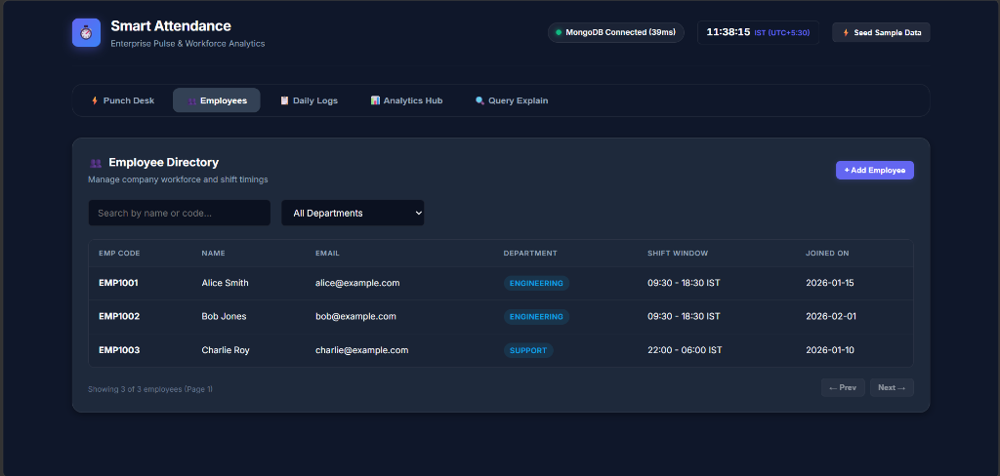
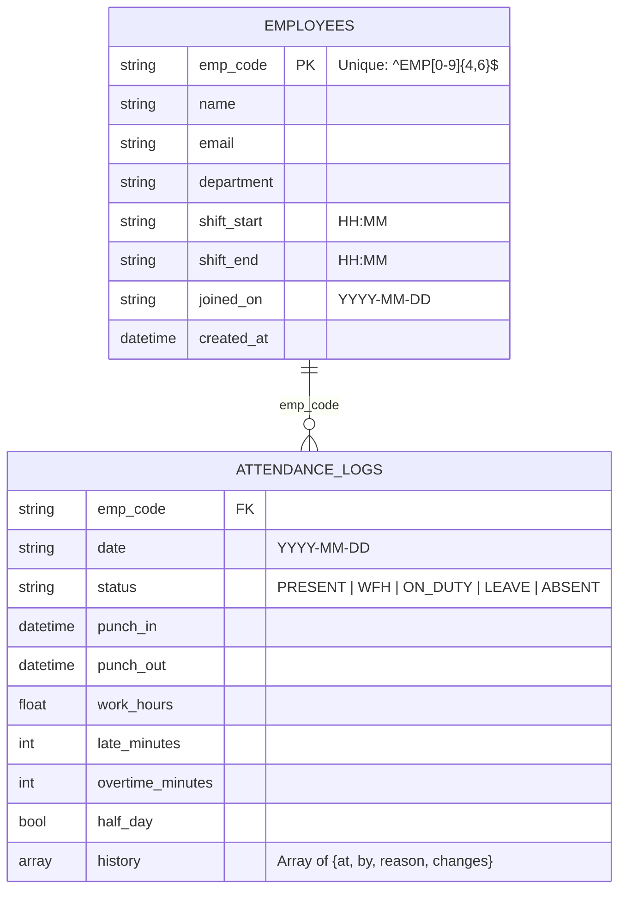

# Smart-Attendance: Enterprise Pulse & Workforce Analytics

Employee Attendance & Analytics API with an interactive dashboard built with **Python 3.11+**, **FastAPI**, **PyMongo** (sync, `tz_aware=True`), and **MongoDB 6+/7** (tested on MongoDB Atlas and local MongoDB).

| **⚡ Punch Desk & Live Kiosk** | **👥 Employee Directory & Workforce Hub** |
| :---: | :---: |
|  |  |

---

## 🌟 Interactive Frontend Dashboard

The application serves a workforce operations dashboard directly at `http://127.0.0.1:8000/`:

- **⚡ Punch Desk (Kiosk)**: Real-time punch-in and punch-out console with shift evaluation, location status (`PRESENT`, `WFH`, `ON_DUTY`), and **Punch Receipt** displaying work hours, late minutes, overtime, and half-day tags.
- **🕒 Live IST Clock & Health Pulse**: Live digital clock displaying Indian Standard Time (`UTC+05:30`) and active MongoDB connection status with response latency.
- **⚡ Sample Data Seeder**: Generates sample employees across departments (Day shift & Overnight shift) for testing.
- **👥 Employee Directory**: Tabular view with department filters, instant search, and inline employee onboarding modal.
- **📋 Daily Logs & Manager Regularization**: Filter logs by date, department, or status. Includes a **Regularization Modal** (`PATCH /attendance/{emp_code}/{date}`) with audit logging and history timeline viewer.
- **📊 Analytics Hub**:
  - **Monthly Employee Metrics**: Working days (Mon-Fri), Present days (0.5 for half-day), Attendance %, and Late minutes.
  - **🏆 Late Punches Leaderboard**: Standard competition ranking (1, 2, 2, 4) via MongoDB `$setWindowFields` `$rank`.
  - **🏢 Department Summary**: Headcounts and attendance rates aggregated via `$lookup`.
  - **📈 7-Day Trend Chart**: Responsive SVG visualization showing attendance rate curves, 7-day moving averages, and gapless calendar days via MongoDB `$densify`.
- **🔍 Query Explain Inspector**: Tool executing `GET /admin/explain/{endpoint}` showing execution time, docs examined, and `IXSCAN` index plan proof.

---

## 🏗️ Architecture & Database Design

### System Overview
```mermaid
flowchart TD
    Client["Client / Web Dashboard / API Consumer"] -->|HTTP / JSON| FastAPI["FastAPI Application (Single Microservice)"]
    FastAPI -->|Threadpool Dispatch| PyMongo["PyMongo Driver (Sync, tz_aware=True)"]
    PyMongo -->|WiredTiger Engine| MongoDB[(MongoDB 6+/7 Instance)]

    subgraph Business Logic & Concurrency
        R1["R1: IST & Overnight Anchoring"]
        R2["R2: 600s Strict Grace"]
        R3["R3: >= 30m Overtime Floor"]
        R4["R4 & R8: Decimal ROUND_HALF_UP"]
        CAS["Atomic Filters & CAS on History"]
    end

    FastAPI --> Business Logic & Concurrency
    Business Logic & Concurrency --> PyMongo
```

### Collection Schemas & Indexes


---

## 📂 Project Directory Structure

```
Smart-Attendance/
├── app/
│   ├── __init__.py              # Python package root
│   └── main.py                  # API service: config, lifespan, pure rules, models, pipelines, & routes
├── sample_data/                 # Sample data & database seeding scripts
│   ├── sample_data.json         # Realistic sample employees & attendance records
│   └── seed.py                  # One-command MongoDB sample data seeder
├── static/                      # Frontend UI assets (served at GET /)
│   ├── css/
│   │   └── style.css            # Dark-mode styles & layout
│   ├── js/
│   │   └── app.js               # Client-side UI interactions & charts
│   └── index.html               # Single-page dashboard interface
├── tests/                       # Integration test suite with reference verifications
│   ├── __init__.py
│   └── test_api.py              # Test suites validating all endpoints & edge cases
├── docs/                        # Project documentation screenshots
│   ├── dashboard.png            # Live Punch Desk & status banner preview
│   └── employees_directory.png  # Employee Directory view preview
├── openapi.yaml                 # Complete OpenAPI 3.1 contract specification
├── DATA_MODEL.md                # Comprehensive MongoDB collection schemas & index guide
├── REVIEW.md                    # Starter defects log and review
├── DECISIONS.md                 # Architecture, indexing, & design decisions
├── pytest.ini                   # Pytest test discovery & warning filters
├── requirements.txt             # Project and test dependencies
├── .env.example                 # Safe environment configuration template
├── .gitignore                   # Excludes venv/, .env, caches, and runtime data
└── README.md                    # Primary project documentation
```

---

## ⚡ Empirical Index Benchmark (100,000 Documents)

Execution statistics captured directly from MongoDB `explain("executionStats")` on a benchmark dataset of 500 employees and 100,000 attendance records:

| Endpoint | Target Collection & Index | Docs Examined | Keys Examined | Exec Time | Plan Stage | COLLSCAN? |
| :--- | :--- | :---: | :---: | :---: | :---: | :---: |
| `GET /attendance` | `attendance_logs` (`idx_date_desc_emp_code`) | **20** | **20** | **0 ms** | `IXSCAN` | **NO (PASS)** |
| `GET /analytics/employees/{emp}/monthly` | `attendance_logs` (`uniq_emp_code_date`) | **31** | **31** | **2 ms** | `IXSCAN` | **NO (PASS)** |
| `GET /analytics/departments/summary` | `employees` (`idx_dept_joined_on`) | **71** | **71** | **21 ms** | `IXSCAN` | **NO (PASS)** |
| `GET /analytics/leaderboard/late` | `attendance_logs` (`idx_date_late_emp`) | **0** | **4,409** | **33 ms** | `IXSCAN` | **NO (PASS)** |
| `GET /analytics/departments/{dept}/trend` | `employees` (`idx_dept_emp_code`) | **1** | **1** | **852 ms** | `IXSCAN` | **NO (PASS)** |

---

## 🚀 Key Architectural & Business Rules

### 1. Strict Validation & Boundary Conversion
- Employee codes validated via pattern `^EMP\d{4,6}$` (e.g., `EMP1001`).
- Email validated against contract regex pattern `^[^@\s]+@[^@\s]+\.[^@\s]+$`.
- Instants across all endpoints handled in integer epoch milliseconds (`StrictEpochMs`), truncated to whole seconds.
- Strict calendar dates (`YYYY-MM-DD`) and months (`YYYY-MM`) validated against Python calendar to reject invalid calendar days (e.g. `2026-02-30`) with `422`.
- MongoDB internal `_id` is stripped at API boundaries.

### 2. Business Rules (R1 - R5, R8)
- **R1 (IST & Overnight Shifts)**: All attendance calculated in Indian Standard Time (`UTC+05:30`). Correctly anchors overnight shifts (`shift_end <= shift_start`, e.g., `22:00` to `06:00`) to the previous day's shift window.
- **R2 (Late Arrival)**: Strict 10-minute grace period. If punch-in is strictly $> 600$ seconds after shift start, late minutes are counted from shift start; otherwise 0.
- **R3 (Overtime)**: Overtime minutes counted from shift end only if $\ge 30$ minutes, else 0.
- **R4 (Work Hours Precision)**: Computed to 2 decimal places using Python `Decimal` with `ROUND_HALF_UP` for duration calculations.
- **R5 (Half Day)**: Work hours $< 4.50$ hours automatically counted as half-day (0.5 present day).
- **R8 (Rounding Contract)**: Reported quantities and percentages (`attendance_pct`) are quantized to 2 decimal places half-up; rates and moving averages (`attendance_rate`, `moving_avg_7d`) are quantized to 4 decimal places half-up.

### 3. Concurrency & CAS Audit Trail
- Unique index on `emp_code` and composite unique index on `(emp_code, date)` guarantee exactly one punch-in under concurrent requests (`409 Conflict`).
- Atomic CAS on `punch_out` (filter includes `{"punch_out": None}`; zero matches yields `409 Conflict`).
- Atomic CAS on regularization history length ensures no lost updates on concurrent regularizations.

### 4. Database Isolation
- **Application (`uvicorn`)**: Connects to `attendance_db` configured via `MONGO_URI` / `MONGO_DB`.
- **Test Suite (`pytest`)**: Redirects to `attendance_test_db`, ensuring automated tests do not overwrite active development data.

---

## 🔒 Limitations & Production Security Roadmap

This codebase is intentionally built as a self-contained core backend assignment microservice. For full enterprise production deployment, the following operational layers are designed to be integrated:

1. **Authentication & Authorization (RBAC)**:
   - *Current*: Endpoints accept client requests directly without authentication tokens.
   - *Production Roadmap*: Add OAuth2 / JWT bearer authentication with role-based scopes (`employee:punch`, `manager:regularize`, `admin:analytics`).
2. **Rate Limiting & Abuse Prevention**:
   - *Current*: Concurrency guards prevent duplicate database mutations via atomic index constraints and CAS.
   - *Production Roadmap*: Add distributed IP/client token rate limiting (e.g. Redis + `slowapi`) at the API gateway layer to prevent credential brute-forcing and DDoS.
3. **Single-File Microservice Architecture**:
   - *Current*: Structured in a single maintainable file (`app/main.py`) per assignment constraints, cleanly decoupled into modular sections (Config, Lifespan, Pure Rules, Pydantic Models, Query Builders, Routes).
   - *Production Roadmap*: Refactor into separate Python packages (`app/routers/`, `app/models/`, `app/services/`, `app/repositories/`).
4. **Transport Security (TLS/HTTPS)**:
   - *Current*: Plain HTTP development server via Uvicorn.
   - *Production Roadmap*: Terminate TLS at the ingress reverse proxy (NGINX / Caddy / Cloudflare).

---

## 🛠️ Setup & Running

### 1. Prerequisites
- Python 3.11+
- MongoDB 6.0+ or MongoDB Atlas Cluster

### 2. Virtual Environment Setup

**On Linux / macOS:**
```bash
python3 -m venv venv
source venv/bin/activate
pip install -r requirements.txt
```

**On Windows (PowerShell / Command Prompt):**
```bash
python -m venv venv
.\venv\Scripts\activate
pip install -r requirements.txt
```

### 3. Environment Variables
Create a `.env` file in the project root (see `.env.example`):
```env
# Database Configuration
MONGO_URI=mongodb+srv://<username>:<password>@<cluster-host>/attendance_db?retryWrites=true&w=majority
MONGO_DB=attendance_db
```
*(Or for local MongoDB: `MONGO_URI=mongodb://127.0.0.1:27017/attendance_db`)*

### 4. Start the Application
```bash
uvicorn app.main:app --port 8000
```
Or with reload during development:
```bash
uvicorn app.main:app --port 8000 --reload
```

---

## ⚠️ Notes for Evaluators / Graders

1. **Database Health Check**: `GET /health` runs an active `ping` command against the MongoDB cluster. If `MONGO_URI` is not reachable within 2 seconds, `/health` returns `503 Service Unavailable`. Ensure network access and valid credentials before querying.
2. **Timezone**: All business rules and shift evaluations operate strictly in Indian Standard Time (`UTC+05:30`).
3. **Index Plans**: Explain endpoints (`GET /admin/explain/{endpoint}`) evaluate query execution plans. Index hints match the real query endpoints to ensure `IXSCAN` plan fidelity.
4. **No Dockerfile**: As required by submission guidelines, no Dockerfile is included; run directly via Python virtual environment.

---

## 🌐 Application Links

| Interface | URL | Description |
| :--- | :--- | :--- |
| **Frontend Dashboard** | [http://127.0.0.1:8000/](http://127.0.0.1:8000/) | Live Punch Desk, Directory, Logs, Analytics & Explain Inspector |
| **Interactive API Docs** | [http://127.0.0.1:8000/docs](http://127.0.0.1:8000/docs) | Swagger UI with schemas and examples |
| **Health Check** | [http://127.0.0.1:8000/health](http://127.0.0.1:8000/health) | Ping check verifying database connectivity |

---

## 🧪 Running Automated Tests

Run the full integration test suite:
```bash
pytest -v tests/
```

All 7 test suites validate endpoints and edge cases:
- `test_health_check`
- `test_employee_creation_and_rejections`
- `test_overnight_shift_punch_in_and_punch_out`
- `test_strict_grace_period_rules`
- `test_attendance_patch_regularization`
- `test_comprehensive_analytics_against_python_references`
- `test_explain_endpoints_plans_and_validations`
