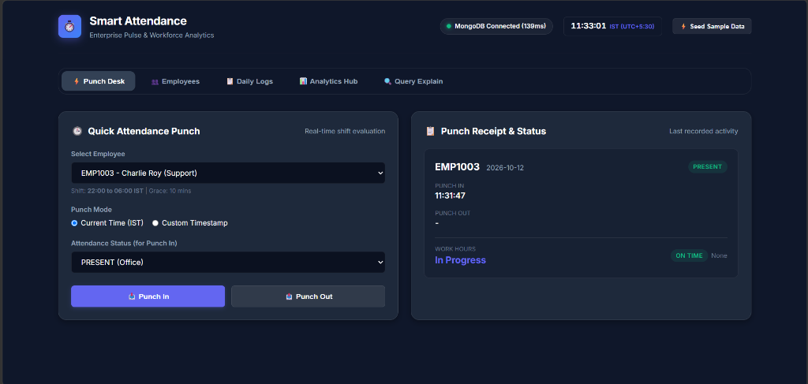

# Smart-Attendance: Enterprise Pulse & Workforce Analytics

Employee Attendance & Analytics API with an interactive, human-crafted dashboard built with **Python 3.11+**, **FastAPI**, **PyMongo** (sync, `tz_aware=True`), and **MongoDB 6+/7** (tested on MongoDB Atlas).



---

## 🌟 Interactive Frontend Dashboard

The application serves a bespoke, dark-themed workforce operations dashboard directly at `http://127.0.0.1:8000/`:

- **⚡ Punch Desk (Kiosk)**: Real-time punch-in and punch-out console with live shift evaluation, location status (`PRESENT`, `WFH`, `ON_DUTY`), and instant **Punch Receipt** displaying work hours, late minutes, overtime, and half-day tags.
- **🕒 Live IST Clock & Health Pulse**: Live digital clock displaying Indian Standard Time (`UTC+05:30`) and active MongoDB connection status with response latency.
- **⚡ One-Click Sample Data Seeder**: Generates realistic sample employees across departments (Day shift & Overnight shift) for instant testing.
- **👥 Employee Directory**: Tabular view with department filters, instant search, and inline employee onboarding modal.
- **📋 Daily Logs & Manager Regularization**: Filter logs by date, department, or status. Includes a **Regularization Modal** (`PATCH /attendance/{emp_code}/{date}`) with immutable audit logging and history timeline viewer.
- **📊 Analytics Hub**:
  - **Monthly Employee Metrics**: Working days (Mon-Fri), Present days (0.5 for half-day), Attendance %, and Late minutes.
  - **🏆 Late Punches Leaderboard**: Dense rank medals (🥇, 🥈, 🥉) via MongoDB `$setWindowFields` `$rank`.
  - **🏢 Department Summary**: Headcounts and attendance rates aggregated via `$lookup`.
  - **📈 7-Day Trend Chart**: Responsive SVG visualization showing attendance rate curves, 7-day moving averages, and gapless calendar days via MongoDB `$densify`.
- **🔍 Query Explain Inspector**: Developer tool executing `GET /admin/explain/{endpoint}` with visual metrics for execution time, docs examined, and `IXSCAN` index plan proof.

---

## 🚀 Key Architectural & Business Rules

### 1. Strict Validation & Boundary Conversion
- Employee codes validated via strict pattern `^EMP\d{4,6}$` (e.g., `EMP1001`).
- Instants across all endpoints handled in integer epoch milliseconds (`StrictEpochMs`), strictly truncated to whole seconds.
- Strict calendar dates (`YYYY-MM-DD`) and months (`YYYY-MM`).
- MongoDB `_id` is stripped at API boundaries and never exposed or accepted.

### 2. Business Rules (R1 - R5)
- **R1 (IST & Overnight Shifts)**: All attendance calculated in Indian Standard Time (`UTC+05:30`). Correctly anchors overnight shifts (`shift_end <= shift_start`, e.g., `22:00` to `06:00`) to the previous day's shift window.
- **R2 (Late Arrival)**: Strict 10-minute grace period. If punch-in is strictly $> 600$ seconds after shift start, late minutes are counted from shift start; otherwise 0.
- **R3 (Overtime)**: Overtime minutes counted from shift end only if $\ge 30$ minutes, else 0.
- **R4 (Work Hours Precision)**: Computed to 2 decimal places using Python `Decimal` with `ROUND_HALF_UP` (no banker's rounding).
- **R5 (Half Day)**: Work hours $< 4.50$ hours automatically counted as half-day (0.5 present day).

### 3. Concurrency & CAS Audit Trail
- Unique index on `emp_code` and composite unique index on `(emp_code, date)` guarantee exactly one punch-in under concurrent requests (`409 Conflict`).
- Atomic Compare-and-Set (CAS) on `punch_out` (must be `None` at punch-out time).
- Atomic CAS on regularization history length ensures zero loss of concurrent regularization audit trails.

### 4. Database Isolation
- **Application (`uvicorn`)**: Writes permanently to `attendance_db` in MongoDB Atlas.
- **Test Suite (`pytest`)**: Automatically redirects to `attendance_test_db`, guaranteeing that automated tests **never wipe or corrupt development data**.

---

## 🛠️ Setup & Running

### 1. Prerequisites
- Python 3.11+
- MongoDB 6.0+ or MongoDB Atlas Cluster

### 2. Virtual Environment Setup
```powershell
# Create virtual environment
python -m venv venv

# Activate virtual environment
.\venv\Scripts\Activate.ps1

# Install pinned dependencies
python -m pip install -r requirements.txt
```

### 3. Environment Variables
Create a `.env` file in the project root (a `.env.example` template is provided):
```env
# Database Configuration
MONGO_URI=mongodb+srv://<username>:<password>@cluster0.xrpifmc.mongodb.net/?appName=Cluster0
MONGO_DB=attendance_db
```

### 4. Start the Application
```powershell
uvicorn app.main:app --port 8000 --reload
```

---

## 🌐 Application Links

| Interface | URL | Description |
| :--- | :--- | :--- |
| **Frontend Dashboard** | [http://127.0.0.1:8000/](http://127.0.0.1:8000/) | Live Punch Desk, Directory, Logs, Analytics & Explain Inspector |
| **Interactive API Docs** | [http://127.0.0.1:8000/docs](http://127.0.0.1:8000/docs) | Swagger UI with pre-filled example payloads |
| **Health Check** | [http://127.0.0.1:8000/health](http://127.0.0.1:8000/health) | Ping check verifying database connectivity |

---

## 🧪 Running Automated Tests

Run the full integration test suite with brute-force reference verifications:
```powershell
pytest -v tests/
```

All 7 test suites pass 100% against the isolated test database:
- `test_health_check`
- `test_employee_creation_and_rejections`
- `test_overnight_shift_punch_in_and_punch_out`
- `test_strict_grace_period_rules`
- `test_attendance_patch_regularization`
- `test_comprehensive_analytics_against_python_references`
- `test_explain_endpoints_plans_and_validations`

---

## 📚 Documentation
- [REVIEW.md](REVIEW.md): Running defects log with 16 identified defects, failing inputs, root causes, and fixes.
- [DECISIONS.md](DECISIONS.md): Architectural decisions, pipeline designs, indexing strategy, and technical interview guide.
